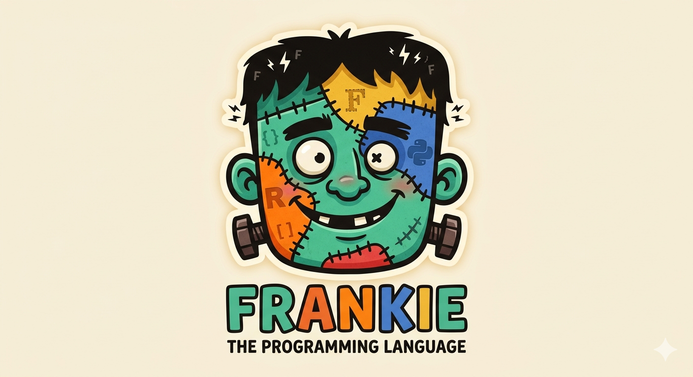

# Welcome to Frankie - The Programming Language Docs



<div align="center"><h2>Latest version: <a href="https://github.com/atejada/Frankie/releases/tag/v1.22.3">Frankie v1.22.3</a></h2></div>

<h2>A procedural programming language lovingly stitched together from Ruby, Python, R, and Fortran. Zero dependencies. Proudly monstrous.</h2>

<h2>No install? <a href="https://atejada.github.io/frankielanguage/#playground" target="_blank">Try Frankie in your browser</a> — see <a href="getting_started/playground/">The Playground</a></h2>

<h2>For Frankie's website visit <a href="https://atejada.github.io/frankielanguage/" target="_blank">The Frankie Language</a></h2>

## Hello, Frankie

```ruby
name = "world"
puts "Hello, #{name}!"

for i in 1..3
  puts "#{i} squared is #{i ** 2}"
end
```

## Install in 30 seconds

```bash
brew install atejada/frankie/frankie
frankiec run hello.fk
```

No Homebrew? Clone the repo and run `python3 install.py`, or [try it in your browser](getting_started/playground.md) with nothing to install. See [Installation](getting_started/installation.md).

## Where to go next

- **[Installation](getting_started/installation.md)** and **[CLI Commands](getting_started/cli_commands.md)** — `frankiec run`, `test`, `check`, `fmt`, `repl`, `new`, `watch`.
- **[Language](language/variables_and_types.md)** — variables, operators, conditionals, loops (including labeled loops), functions, error handling, modules.
- **[Data Types](data_types/index.md)** — Integer, Float, String, Vector, Hash, Lambda, Record.
- **[Standard Library](standard_library/math_statistics.md)** — math and matrices, files, JSON/CSV, HTTP, SQLite, a built-in web server, testing, regex and more.
- **[Stitches](stitches/index.md)** — reusable library modules loaded with `stitch "name"`.
- **[Examples](examples/index.md)** and **[Showcase](examples/showcase.md)** — runnable programs, from FizzBuzz to games.
- **[Changelog](reference/changelog.md)** and **[Full Stdlib Index](reference/full_index.md)** — every release and every function.

## For AI agents and tools

Plain-markdown access to these docs: [`llms.txt`](https://atejada.github.io/frankielanguage/site/llms.txt) (index) and [`llms-full.txt`](https://atejada.github.io/frankielanguage/site/llms-full.txt) (everything in one file). Every page also has a `.md` twin, e.g. `getting_started/playground.md`.
